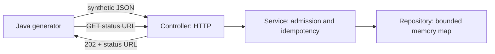

# QueueDesk

A small Java/Spring Boot learning lab for synthetic payment **instructions**. Start with one request and explain each boundary before adding infrastructure.

**Current milestone: L0 foundation plus an in-memory HTTP rehearsal.** The PRD's durable L1 is still ahead. HTTP `202` here means stored in this process's memory, **not committed to a database**, delivered to MQ, or paid. Every admitted record remains `RECEIVED`, with delivery `NOT_CONFIGURED`. Restarting clears all records and idempotency keys. No banking integrations or money movement exist.



## Run your first loop

From a terminal:

```sh
cd ~/projects/queuedesk
./mvnw test
./scripts/generate --seed 42 --count 10
./mvnw spring-boot:run
```

The wrappers select the installed macOS JDK 25 (currently 25.0.4.1), even though the shell's default is Java 27. On another machine, set `JAVA_HOME` to JDK 25. `./mvnw` is a short custom wrapper: it downloads checksum-pinned Maven 3.9.11 and dependencies into this project's ignored `.cache/`; it installs nothing globally. First build needs internet. Spring Boot is pinned to 4.0.8, whose [official compatibility range](https://docs.spring.io/spring-boot/4.0/system-requirements.html) includes Java 25. No Docker is required.

In a second terminal:

```sh
cd ~/projects/queuedesk
./scripts/generate --seed 42 --count 1 --run-id first --send
curl -s 'http://127.0.0.1:8080/api/v1/instructions?runId=first'
# Repeat the exact request: reports HTTP 200 and retains the same instruction ID.
./scripts/generate --seed 42 --count 1 --run-id first --send
./scripts/generate --scenario invalid --count 4 --run-id invalid-demo --send
```

Stop the API with Ctrl-C. Start it again and repeat the GET: it returns `[]`. That loss is intentional evidence of the adapter boundary. Use `./mvnw package` to build `target/queuedesk-0.1.0.jar`. `./scripts/smoke` runs a real local HTTP/generator check, starts its own instance on port 18080, and stops that instance automatically. Python 3 is used only by this test script.

## Read these files in order

1. `src/main/java/dev/queuedesk/domain/PaymentInstruction.java`: immutable record, `Long` vs primitive `long`, constructor validation. Optional wrapper type lets us reject a missing amount. USD minor units avoid floating-point money.
2. `src/test/java/dev/queuedesk/domain/PaymentInstructionTest.java`: validation with no Spring context.
3. `tools/Generate.java`: `Random(seed)`, collections, record, HTTP client, finite work and explicit sending.
4. `src/main/java/dev/queuedesk/http/InstructionController.java`: like a focused Express route; annotations bind headers, paths and JSON.
5. `src/main/java/dev/queuedesk/service/AdmissionService.java`: constructor injection, use case, duplicate vs conflict.
6. `src/main/java/dev/queuedesk/repository/InstructionRepository.java` and `InMemoryInstructionRepository.java`: an interface and a concrete adapter.
7. `src/test/java/dev/queuedesk/http/InstructionApiTest.java`: HTTP contracts using MockMvc.

**Next exercise:** add a test for the maximum permitted amount, then deliberately break its validation and read the failure. Trace one POST from controller to record to service to repository. Explain why a second correlation ID does not create another instruction. After that, replace the map with Postgres and prove restart survival; see [milestones](docs/MILESTONES.md).

## HTTP rehearsal contract

`POST /api/v1/instructions` requires `Idempotency-Key`; `X-Correlation-Id` is optional. Request:

```json
{"clientReference":"demo-0001","runId":"demo","senderParticipant":"SENDER_A","receiverParticipant":"RECEIVER_B","amountMinor":12500,"currency":"USD"}
```

- `202`: new instruction in memory, `Location` and JSON `statusUrl` for GET.
- `200`: same trimmed key and normalized payload, same ID. Correlation is metadata excluded from semantic equality; the original admission correlation is retained.
- `409`: key reused with another business payload; original stays intact.
- `400`: invalid JSON, unknown fields, fractional/missing/nonpositive/over-cap amount, wrong currency/participants, invalid token/header/parameter.
- `404`: unknown instruction ID.
- `503`: map contains 1000 records; repeat of an existing record still works.

`GET /api/v1/instructions/{id}` returns the stored payload and status. `GET /api/v1/instructions?runId=demo&limit=50` lists at most 100 records in admission order. Pagination cursors, status filtering, explicit 16 KiB body enforcement, durable semantic hashes, and database unique constraints remain future work. This local lab has no authentication. Keep the loopback binding.

## Generator contract at this milestone

Defaults: dry-run, seed 42, 20 submissions, rate 2/sec, concurrency 1, 5-second request/connect timeout, 60-second run cap. `--send` explicitly enables HTTP. Only `http://127.0.0.1:<port>` is allowed; DNS hostnames, proxies and redirects are disabled. Caps: 500 planned attempts, 10/sec, and the planned count must fit the 60-second cap. Burst defaults to 10/sec, still sequential. Use a new `--run-id` for a new scenario; reuse the original options/key/body after ambiguous admission.

```sh
./scripts/generate --scenario normal --seed 42 --count 10 --run-id normal-demo --send
./scripts/generate --scenario duplicate --seed 42 --count 10 --run-id duplicates-demo --send
./scripts/generate --scenario burst --seed 42 --count 10 --run-id burst-demo --send
./scripts/generate --scenario invalid --seed 42 --count 4 --run-id invalid-demo --send
```

`count` includes duplicate attempts (every fifth attempt repeats the preceding one). Invalid cycles through zero amount, negative amount, EUR, and missing sender. Same seed/options reproduce exact dry-run output. The configuration includes `attemptAmountMinorTotal`, summing attempted payload amounts (including duplicates and deliberately invalid amounts); it is a lab inspection total, not a settled value. Live output reports per-request HTTP latency and admission counts. Exit 0 means expected **admission** responses; exit 1 means unexpected responses/configuration; exit 2 means admission uncertainty or unsent work. No automatic retries or outcome polling are implemented. Full PRD scenario assertions, latency distributions and completion reports require later worker milestones. HTTP success never implies processing success.

## Source specification and visual map

The full source PRD is preserved, separate from these implementation notes:

- [Full PRD Markdown](docs/QueueDesk_PRD.md)
- [Full PRD PDF](docs/QueueDesk_PRD.pdf)
- [Learning stages](docs/images/QueueDesk_Learning_Path.png)
- [Spring layers](docs/images/QueueDesk_Spring_Layers.png)
- [Target architecture](docs/images/QueueDesk_Architecture.png)
- [Mock participants](docs/images/QueueDesk_Mock_Participants.png)
- [Data model](docs/images/QueueDesk_Data_Model.png)
- [Status model](docs/images/QueueDesk_Status_Model.png)
- [Outbox recovery](docs/images/QueueDesk_Outbox_Recovery.png)

The seven diagrams describe the target design, not implemented infrastructure. [Source provenance](docs/SOURCES.json) retains exact Library IDs, versions, byte sizes and SHA-256 hashes. All source assets are unchanged. No credentials, real customer data, remote repository, cloud resources, or paid services are needed.
