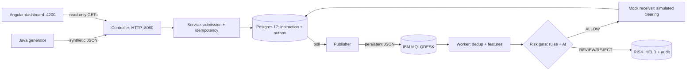

# QueueDesk

QueueDesk is a practice project that shows how a payment instruction can move safely from an API call to a settled payment. It accepts fake payments over HTTP, stores them in Postgres, passes them through IBM MQ, checks them for fraud risk, simulates settlement, and shows the whole journey in a read-only dashboard. Everything runs on your own machine with made-up senders, receivers, and money.

The lab is complete as of 6 October 2026. It includes the durable payment flow, retries and quarantine, failure drills, logs and tracing, the dashboard, a local Kubernetes (kind) deployment, and the fraud-risk check, including a live trial of the Jev AI provider ($0.00006 spent of a $1 cap). The backend has 177 passing tests, the dashboard has 74 passing specs, and `./scripts/verify` passes end to end.

## Quick start

You need JDK 25, Docker Desktop (Postgres and IBM MQ run as containers), and Node 24 for the dashboard. The first build downloads dependencies, so it needs an internet connection.

```sh
./start-lab
# API:       http://127.0.0.1:8080
# Dashboard: http://127.0.0.1:4200
# Logs:      /tmp/qdesk-app.log and /tmp/qdesk-dashboard.log
```

`start-lab` starts the containers, waits for MQ, and starts the app (which runs the database migrations on boot) and the dashboard. Containers restart cleanly, but the script refuses to start when ports 8080 or 4200 already answer, so stop a running lab before starting it again. To stop, use the `kill` line it prints, then run `./scripts/mq down` and `./scripts/postgres down`. Your data stays in the container volumes.

On macOS the scripts pick JDK 25 for you, even if your shell defaults to another version. On other machines, set `JAVA_HOME` to a JDK 25 installation first.

Send your first payment from a second terminal:

```sh
./scripts/generate --run-id first --count 1 --seed 42 --send --observe
curl -s 'http://127.0.0.1:8080/api/v1/instructions?runId=first&order=desc'
```

Send the exact same payment again:

```sh
./scripts/generate --run-id first --count 1 --seed 42 --send
```

The repeat returns HTTP 200 with the original payment ID and creates nothing new. That is idempotency doing its job. Now open the dashboard, type `first` into a run box, and follow the same payment from the read side.

## How a payment flows through the system



A payment passes through seven stages. Each stage either saves its result or leaves the payment clearly marked as pending.

1. **Front door.** `POST /api/v1/instructions` checks the request and its `Idempotency-Key` header. A new payment gets a 202. An exact repeat gets a 200 and keeps the original ID. The same key with a different body gets a 409, and an invalid request gets a 400. The lab only allows sender `SENDER_A`, receiver `RECEIVER_B`, USD amounts of 1 to 10,000,000 minor units (cents), and bodies up to 16 KiB.
2. **Written down.** The payment and an outbox event are saved together in one Postgres transaction. The 202 response means "safely stored here." It does not mean "delivered."
3. **Conveyor belt.** A publisher polls the outbox and sends each event to the MQ queue `QUEUEDESK.INSTRUCTION.IN` as a persistent message. It always reuses the same event ID, so a retry can never create a second, different event. If MQ is down, new payments still get a 202, and the backlog drains when MQ recovers.
4. **Sorter.** A single-threaded worker reads each message in a transaction, ignores duplicates by event ID, works out the risk features (amount, recent payment speed, recipient history), and asks the risk gate before anything settles.
5. **Security check.** Fixed rules can hold a payment for review, for example a new recipient (`NEW_RECIPIENT`) or an unusual amount (`UNUSUAL_AMOUNT`). A payment of $95,000 or more to a stranger is rejected. An AI provider can also answer two yes/no questions to add context. The verdict is `ALLOW`, `REVIEW`, `REJECT`, or `NOT_ASSESSED`. If anything fails during the check, the payment is held. It is never waved through.
6. **Cashier.** A mock receiver completes the payment, rejects it, or gives an uncertain answer. If its reply is lost, QueueDesk reconciles from the receiver result it stored. If the receiver is truly unknown, the payment stays visibly pending with an open task instead of pretending to be done.
7. **Receipt filed.** The final state and a full audit trail land in Postgres, and the dashboard shows every step.

Prefer pictures? Start with the [one-page infographic](docs/QueueDesk_Infographic.html) ([PNG version](docs/images/QueueDesk_How_It_Works.png)) or the [slide deck](docs/QueueDesk_Slidedeck.html) ([PDF](docs/QueueDesk_Slidedeck.pdf)).

## Everyday commands

| Command | What it does |
|---|---|
| `./scripts/generate --run-id w1 --count 50 --scenario risk-2 --send --observe` | Generates seeded test payments, sends them, and watches them finish |
| `./scripts/reset-lab` | Clears run data and drains the queues; also zeroes the Jev spending ledger |
| `./scripts/verify` | Runs every gate: unit tests, a smoke test, and the 12 failure scenarios SC01 to SC12 |
| `./scripts/k8s-verify` | Builds the image, deploys to a local kind cluster, runs drills, and tears the cluster down |

The generator only prints what it would send unless you pass `--send`. It sends at `--rate` payments per second (1 to 10), and `--observe` polls until each payment reaches a final state. The same seed and options always produce the same payments. Exit code 0 means every check passed, 1 means an unexpected response, and 2 means some work was left unsent or unresolved.

The lab stores at most 1,000 live payments and stops accepting traffic when free disk drops below 10 GB, so run `./scripts/reset-lab` between experiments.

Scenarios you can generate: `normal`, `burst`, `duplicate`, `conflict`, `invalid`, `reject`, `uncertain`, `unknown`, and `risk-1` to `risk-6`. For a fraud demo, use `risk-2`: every fourth payment is $80,000 to $90,000 and is held as `UNUSUAL_AMOUNT`. On a fresh lab, the first payment is also held as `NEW_RECIPIENT`. The `./scripts/scenarios` command runs the full acceptance catalog and writes JSON reports to `reports/`. Use `./scripts/poison` and `./scripts/redeliver` to run the matching failure drills by hand.

## The fraud-risk check

The `QUEUEDESK_RISK_MODE` environment variable controls the check. It defaults to `OFF`, so the lab starts with the check disabled and payments flow straight to settlement.

| Mode | What happens |
|---|---|
| `OFF` | No risk check |
| `RULES_ONLY` | Only the fixed rules decide |
| `RULES_PLUS_MOCK` | Rules plus a free, deterministic mock AI |
| `RULES_PLUS_JEV` | Rules plus the live Jev model; needs an API key and stays under a $1 budget |

To see payments get held, restart the backend with a mode set:

```sh
kill <backend-pid>   # the first PID printed by start-lab
unset MQ_APP_PASSWORD; QUEUEDESK_RISK_MODE=RULES_PLUS_MOCK ./mvnw spring-boot:run > /tmp/qdesk-app.log 2>&1 &
```

Jev mode reads its key from `QUEUEDESK_RISK_JEV_API_KEY` or from `.cache/jev-secrets/apiKey`. That file is gitignored, should have `chmod 600` permissions, and is never logged. Without a key, the app refuses to start in Jev mode rather than quietly falling back to something weaker. Every successful Jev call records its token usage in the database, and new calls are refused once the recorded total passes the budget. Calls that fail, or happen outside QueueDesk, still spend money on the Jev side that this ledger cannot see. See [RUNBOOK-RISK](docs/RUNBOOK-RISK.md) for the full details.

## API at a glance

`POST /api/v1/instructions` requires an `Idempotency-Key` header. `X-Correlation-Id` is optional. The body looks like this:

```json
{"clientReference":"demo-0001","runId":"demo","senderParticipant":"SENDER_A","receiverParticipant":"RECEIVER_B","amountMinor":12500,"currency":"USD"}
```

| Response | Meaning |
|---|---|
| `202` | New payment stored. The `Location` header and the JSON `statusUrl` field point to its status |
| `200` | Same key and same payment as before. You get the original ID back, and nothing new is created |
| `409` | The key was reused for a different payment. The original stays untouched |
| `400` | Something is invalid: bad JSON, unknown fields, or a bad amount, currency, participant, token, header, or cursor |
| `404` | No payment with that ID |
| `413` | Body larger than 16 KiB |
| `503` | The lab is full (1,000 payments, code `CAPACITY`) or the database is unreachable (code `UNAVAILABLE`). Nothing is deleted, and safe retries work after recovery |

`GET /api/v1/instructions/{id}` returns one payment and its status. `GET /api/v1/instructions?runId=&status=&limit=50&cursor=&order=desc` lists payments. Use `order=desc` for newest first; the default `asc` keeps older callers working. The `X-Next-Cursor` response header holds the token for the next page.

Read-only endpoints also cover runs, quarantine, risk summaries and assessments, queues, telemetry, scenarios, and `/actuator/health/*`. The lab has no login. Keep it bound to loopback (127.0.0.1), as configured.

## Tech stack

| Part | Technology | Notes |
|---|---|---|
| Backend API | Java 25, Spring Boot 4.0.8, Maven 3.9.11 | Port 8080. The Maven wrapper downloads Maven into the gitignored `.cache/` folder |
| Dashboard | Angular 22.2.1, Tailwind 4.3.3, Node 24.21.0 | Port 4200 on loopback. Proxies `/api` and `/actuator` to the backend |
| Database | PostgreSQL 17, Flyway migrations V1 to V10 | Container `qdesk-postgres` on `127.0.0.1:5442`, so a Postgres already using port 5432 is left alone |
| Messaging | IBM MQ 10, queue manager `QDESK` | Container `qdesk-mq` on `127.0.0.1:1414`, with a persistent queue and a backout queue |
| Kubernetes | kind 0.33, cluster `qdesk` | Local only. MQ runs beside the cluster because there is no arm64 MQ image |
| Risk AI | TypeSafe Jev `jev-1.13.0` | Live calls only in `RULES_PLUS_JEV` mode, under the $1 budget |
| Observability | OpenTelemetry (OTLP), JSON logs, Spring Actuator | One trace per payment, separate liveness and readiness checks, and a guards endpoint |

QueueDesk only touches resources named `qdesk-*`. A Homebrew Postgres or another project's containers are never stopped, reused, or reconfigured. Every port binds to loopback.

## Running the tests

- `./mvnw test` runs the full backend suite against real Postgres and real MQ containers. Stop anything already using port 8080 first.
- `./scripts/dashboard test` and `./scripts/dashboard build` run the dashboard specs (on the Node version pinned in `dashboard/.nvmrc`) and build the production bundle.
- `./scripts/verify` runs the whole gate: test suites, smoke test, and scenarios SC01 to SC12, with reports saved under `reports/`. Exit code 0 means PASS.
- `./scripts/k8s-verify` runs the Kubernetes gate: deploy, drills, restarts, an outage test, cluster recreation, and teardown.
- GitHub Actions ([ci.yml](.github/workflows/ci.yml)) runs the Docker-free unit suites first, then an integration job with the named Postgres and MQ containers. A skipped suite fails the build.

Latest recorded results: backend 177 of 177 tests, dashboard 74 of 74 specs, `./scripts/verify` PASS. The dated evidence is in [VERIFICATION.md](docs/VERIFICATION.md).

## Project layout

```
src/main/java/dev/queuedesk/  domain/ http/ service/ repository/ messaging/ worker/ risk/ ops/ fault/
src/main/resources/db/migration/  Flyway V1–V10 (instructions → outbox → worker → quarantine → reconciliation → risk)
src/test/  JUnit suites (unit tests plus @Tag("integration") tests against live containers)
dashboard/src/app/  pages/ (overview, payments, risk, ops, queues, telemetry, scenarios) + core/ + shared/
tools/Generate.java  traffic generator (seeded scenarios, send/observe/report)
scripts/  postgres mq k8s generate scenarios smoke poison redeliver reset-lab verify dashboard
k8s/  kind manifests (app plus in-cluster Postgres; MQ runs adjacent)
docs/  PRD, runbooks, verification log, diagrams, infographic, slide deck
reports/  generated scenario and evaluation reports (gitignored)
```

## Read next

- [Full PRD](docs/QueueDesk_PRD.md) ([PDF](docs/QueueDesk_PRD.pdf)) is the authoritative spec. If an implementation note disagrees with it, the PRD wins.
- [How-it-works infographic](docs/QueueDesk_Infographic.html) and [slide deck](docs/QueueDesk_Slidedeck.html) explain the same flow in plain language.
- Runbooks: [L1 admission](docs/RUNBOOK-L1.md), [L2 outbox and MQ](docs/RUNBOOK-L2.md), [L3 retry and quarantine](docs/RUNBOOK-L3.md), [recovery](docs/RUNBOOK-RECOVERY.md), [risk and live Jev](docs/RUNBOOK-RISK.md), [dashboard](docs/RUNBOOK-UI.md), and [kind](docs/RUNBOOK-K8S.md).
- [Milestones](docs/MILESTONES.md), the [verification log](docs/VERIFICATION.md), and the [dashboard mockups](docs/images/ui/) (ten PNGs that the implementation matches).
- Diagrams: [learning path](docs/images/QueueDesk_Learning_Path.png), [Spring layers](docs/images/QueueDesk_Spring_Layers.png), [architecture](docs/images/QueueDesk_Architecture.png), [mock participants](docs/images/QueueDesk_Mock_Participants.png), [data model](docs/images/QueueDesk_Data_Model.png), [status model](docs/images/QueueDesk_Status_Model.png), [outbox recovery](docs/images/QueueDesk_Outbox_Recovery.png), and [risk gate](docs/images/QueueDesk_Risk_Gate.png).

[docs/SOURCES.json](docs/SOURCES.json) records where the spec and diagrams came from, with source file IDs, versions, byte sizes, and SHA-256 hashes. Nothing in this lab uses real customer data or cloud services. The only possible spend is the optional Jev trial under its $1 cap, and your Jev key stays in your own gitignored `.cache/` folder.

