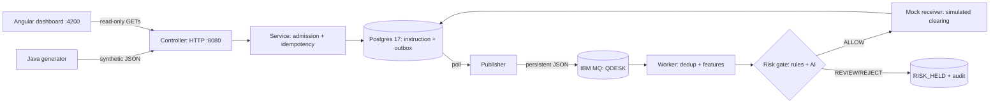

# QueueDesk

A local-only learning lab for synthetic payment **instructions**: idempotent HTTP admission, a transactional outbox over real IBM MQ, a pre-clearing fraud-risk gate (rules + live AI), simulated settlement, and a read-only Angular dashboard. No real money, no real participants, no cloud spend, no deploy target.

**Current state (6 Oct 2026):** all phases complete — durable skeleton (L1), MQ core (L2), retry/quarantine/reconciliation (L3), failure lab + observability, read-only dashboard with mockup parity, local kind deployment, mock-first risk lab, and the **live Jev gate under a $1 cap** ($0.00006 spent). Backend 177/177 tests, dashboard 74/74 specs, `./scripts/verify` green (SC01–SC12 + k8s).



## How it works

One payment travels seven stages; every stage is durable or honestly pending:

1. **Front door** — `POST /api/v1/instructions` validates the payload and honors `Idempotency-Key`: 202 new, 200 exact replay (original ID kept), 409 same key + different body, 400 invalid. Participants are pinned to `SENDER_A`/`RECEIVER_B`, USD only, amounts 1–10,000,000 minor units, body ≤ 16 KiB.
2. **Written down** — instruction + outbox event commit in one Postgres transaction. HTTP 202 means committed locally, not delivered.
3. **Conveyor belt** — the publisher sends each event once (same `eventId` forever) as a persistent message to `QUEUEDESK.INSTRUCTION.IN`. Broker outage? Admissions stay 202 and the outbox drains on recovery.
4. **Sorter** — the worker (concurrency 1, transacted session) dedups by event id, rebuilds features (amount, velocity, recipient history), and calls the risk gate **before** any settlement.
5. **Security check** — deterministic rules fire reason codes (`NEW_RECIPIENT`, `UNUSUAL_AMOUNT` → REVIEW; ≥$95k to a stranger → REJECT); an AI provider optionally answers two yes/no questions as context. Verdicts: ALLOW · REVIEW · REJECT · NOT_ASSESSED. Faults hold, never allow.
6. **Cashier** — a mock receiver completes, rejects, or answers uncertain. Lost replies reconcile from stored receiver truth; truly unknown receivers stay visibly pending with open tasks.
7. **Receipt filed** — terminal state plus a full audit trail in Postgres; the dashboard shows every step.

The one-page visual version: [infographic](docs/QueueDesk_Infographic.html) ([PNG](docs/images/QueueDesk_How_It_Works.png)) and [slide deck](docs/QueueDesk_Slidedeck.html) ([PDF](docs/QueueDesk_Slidedeck.pdf)).

## Stack

| Part | Technology | Notes |
|---|---|---|
| Backend API | Java 25 · Spring Boot 4.0.8 · Maven 3.9.11 | `:8080`, 177 JUnit tests; wrapper downloads Maven into ignored `.cache/` |
| Dashboard | Angular 22.2.1 · Tailwind 4.3.3 · Node 24.21.0 | `:4200` loopback, proxies `/api` + `/actuator`; 74 specs |
| Database | PostgreSQL 17 · Flyway V1–V10 | Container `qdesk-postgres`, `127.0.0.1:5442` (host 5432 untouched) |
| Messaging | IBM MQ 10 · QM `QDESK` | Container `qdesk-mq`, `127.0.0.1:1414`; persistent queue + backout |
| Kubernetes | kind 0.33 · cluster `qdesk` | Local only; MQ stays an adjacent container (no arm64 image) |
| Risk AI | TypeSafe Jev `jev-1.13.0` | Live in `RULES_PLUS_JEV` only; $1 budget, durable token ledger |
| Observability | OpenTelemetry OTLP · JSON logs · Actuator | Trace per instruction, liveness/readiness split, guards endpoint |

Named resources only (`qdesk-*`); host Homebrew Postgres and other projects' containers are never touched. Everything binds loopback.

## Run it

```sh
cd ~/projects/queuedesk
./start-lab
# → API http://127.0.0.1:8080 · dashboard http://127.0.0.1:4200
# → logs /tmp/qdesk-app.log /tmp/qdesk-dashboard.log
```

`start-lab` brings up containers (idempotent), waits for the QM, migrates, and refuses occupied ports. Stop with the `kill` line it prints, plus `./scripts/mq down && ./scripts/postgres down` (volumes keep data). The wrappers select macOS JDK 25 even when the shell default differs; on another machine set `JAVA_HOME` to JDK 25. First build needs internet; Docker Desktop is required (Postgres + MQ run as containers).

Your first loop, in a second terminal:

```sh
./scripts/generate --run-id first --count 1 --seed 42 --send --observe
curl -s 'http://127.0.0.1:8080/api/v1/instructions?runId=first&order=desc'
# Repeat the exact send: HTTP 200, same instruction ID — the repeat creates nothing.
./scripts/generate --run-id first --count 1 --seed 42 --send
```

Then open the dashboard, type `first` in a run box, and watch the same payment from the read side.

## Daily commands

```sh
./scripts/generate --run-id w1 --count 50 --scenario risk-2 --send --observe
./scripts/reset-lab    # truncate run data + drain queues (deliberate; also zeroes the Jev ledger)
./scripts/verify       # all gates: unit suites → smoke → SC01–SC12 failure lab (exit 0 or why not)
./scripts/k8s-verify   # kind deployment gate (builds image, runs drills, tears down)
```

The generator is dry-run by default; `--send` posts at `--rate`/sec (1–10), `--observe` polls to terminal states. Same seed/options reproduce exact output. Exit 0 = assertions pass, 1 = unexpected responses, 2 = unresolved/unsent work. The lab caps live admissions at 1000 rows and halts traffic under 10 GB free disk — reset between runs.

Scenarios: `normal` `burst` `duplicate` `conflict` `invalid` `reject` `uncertain` `unknown` `risk-1`…`risk-6`. The `risk-2` mix is the fraud demo: every 4th payment carries $80k–$90k and holds as `UNUSUAL_AMOUNT` (plus a `NEW_RECIPIENT` hold on the first payment of a fresh lab). `./scripts/scenarios` runs the acceptance catalog with JSON reports under `reports/`; `./scripts/poison` and `./scripts/redeliver` drive the corresponding drills by hand.

## Risk modes

`QUEUEDESK_RISK_MODE` (default `OFF`): `OFF` → `RULES_ONLY` → `RULES_PLUS_MOCK` (free, deterministic) → `RULES_PLUS_JEV` (live model, credential required, $1 budget). The lab boots OFF; to experiment with holds, restart the backend with the mode set:

```sh
kill <backend-pid>   # the first PID printed by start-lab
unset MQ_APP_PASSWORD; QUEUEDESK_RISK_MODE=RULES_PLUS_MOCK ./mvnw spring-boot:run > /tmp/qdesk-app.log 2>&1 &
```

Jev mode reads the key from `QUEUEDESK_RISK_JEV_API_KEY` or `.cache/jev-secrets/apiKey` (chmod 600, gitignored, never logged) and refuses to boot without one — never a silent fallback. Every success persists token usage; the durable SUM ledger refuses new calls past the budget. Failed and out-of-band calls spend Jev-side budget the ledger can't see. Details: [RUNBOOK-RISK](docs/RUNBOOK-RISK.md).

## HTTP contract

`POST /api/v1/instructions` requires `Idempotency-Key`; `X-Correlation-Id` is optional:

```json
{"clientReference":"demo-0001","runId":"demo","senderParticipant":"SENDER_A","receiverParticipant":"RECEIVER_B","amountMinor":12500,"currency":"USD"}
```

- `202` new instruction committed; `Location` + JSON `statusUrl` for GET.
- `200` same trimmed key and normalized payload; original ID and admission correlation retained.
- `409` key reused with another business payload; original stays intact.
- `400` invalid JSON, unknown fields, bad amount/currency/participants/token/header/cursor.
- `404` unknown instruction ID. `413` body over 16 KiB. `503` 1000-row `CAPACITY` cap or unreachable DB (`UNAVAILABLE`) — nothing is cleared, repeats work after recovery.

`GET /api/v1/instructions/{id}` returns payload + status. `GET /api/v1/instructions?runId=&status=&limit=50&cursor=&order=desc` lists newest-first with `order=desc` (default `asc` preserves old callers); the next-page token arrives in `X-Next-Cursor`. Read APIs also serve runs, quarantine, risk summary/assessments, queues, telemetry, scenarios, and `/actuator/health/*`. No authentication in this local lab; keep the loopback binding.

## Testing

- `./mvnw test` — full backend suite vs real Postgres + real MQ (stop anything on :8080 first).
- `./scripts/dashboard test` + `./scripts/dashboard build` — dashboard specs (pinned Node via `.nvmrc`) and production bundle.
- `./scripts/verify` — the whole gate: suites, smoke, SC01–SC12 with stored reports. Exit 0 = PASS.
- `./scripts/k8s-verify` — kind gate: deploy, drills, restarts, outage, cluster recreation, teardown.
- CI (`.github/workflows/ci.yml`) runs unit suites Docker-free first, then the integration job with named PG + MQ; skips fail the build.

Current evidence: backend 177/177, dashboard 74/74, verify PASS — see [VERIFICATION.md](docs/VERIFICATION.md) for the dated log.

## Project layout

```
src/main/java/dev/queuedesk/  domain/ http/ service/ repository/ messaging/ worker/ risk/ telemetry/ fault/
src/main/resources/db/migration/  Flyway V1–V10 (instructions → outbox → risk → Jev usage)
src/test/  JUnit suites (unit + @Tag("integration") vs live containers)
dashboard/src/app/  pages/ (overview payments risk ops queues telemetry scenarios) + core/ + shared/
tools/Generate.java  traffic generator (seeded scenarios, send/observe/report)
scripts/  postgres mq k8s generate scenarios smoke poison redeliver reset-lab verify dashboard
k8s/  kind manifests (app + in-cluster Postgres; MQ adjacent)
docs/  PRD, runbooks, verification log, diagrams, infographic, slide deck
reports/  stored scenario + eval reports (generated, gitignored)
```

## Read next

- [Full PRD](docs/QueueDesk_PRD.md) ([PDF](docs/QueueDesk_PRD.pdf)) — the authoritative spec; implementation notes never override it.
- [How-it-works infographic](docs/QueueDesk_Infographic.html) · [slide deck](docs/QueueDesk_Slidedeck.html) — the plain-language versions.
- Runbooks: [L1 admission](docs/RUNBOOK-L1.md) · [L2 outbox/MQ](docs/RUNBOOK-L2.md) · [L3 retry/quarantine](docs/RUNBOOK-L3.md) · [recovery](docs/RUNBOOK-RECOVERY.md) · [risk + live Jev](docs/RUNBOOK-RISK.md) · [dashboard](docs/RUNBOOK-UI.md) · [kind](docs/RUNBOOK-K8S.md).
- [Milestones](docs/MILESTONES.md) · [verification log](docs/VERIFICATION.md) · [dashboard mockups](docs/images/ui/) (ten PNGs; implementation holds mockup parity).
- Diagrams: [learning path](docs/images/QueueDesk_Learning_Path.png) · [Spring layers](docs/images/QueueDesk_Spring_Layers.png) · [architecture](docs/images/QueueDesk_Architecture.png) · [mock participants](docs/images/QueueDesk_Mock_Participants.png) · [data model](docs/images/QueueDesk_Data_Model.png) · [status model](docs/images/QueueDesk_Status_Model.png) · [outbox recovery](docs/images/QueueDesk_Outbox_Recovery.png) · [risk gate](docs/images/QueueDesk_Risk_Gate.png).

[Source provenance](docs/SOURCES.json) retains exact Library IDs, versions, byte sizes and SHA-256 hashes. All source assets are unchanged. No credentials (except your own gitignored Jev key), real customer data, remote repositories, cloud resources, or paid services beyond the $1 Jev cap are involved.
