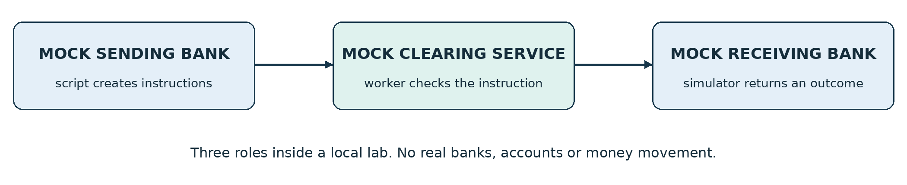
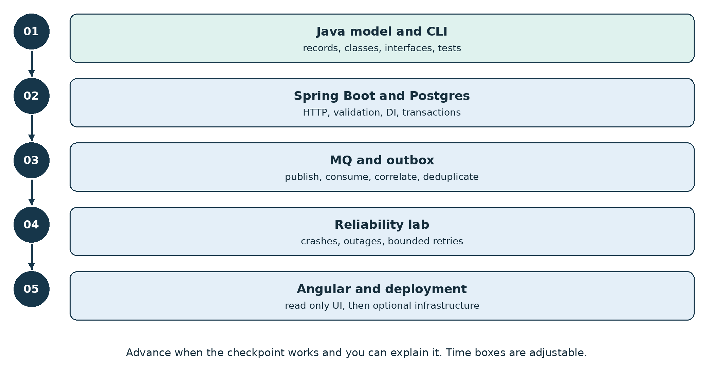
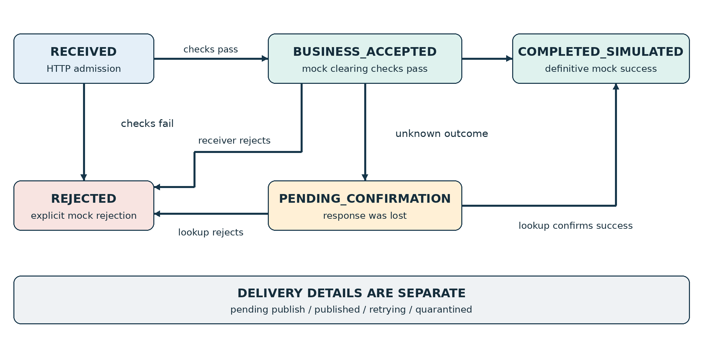
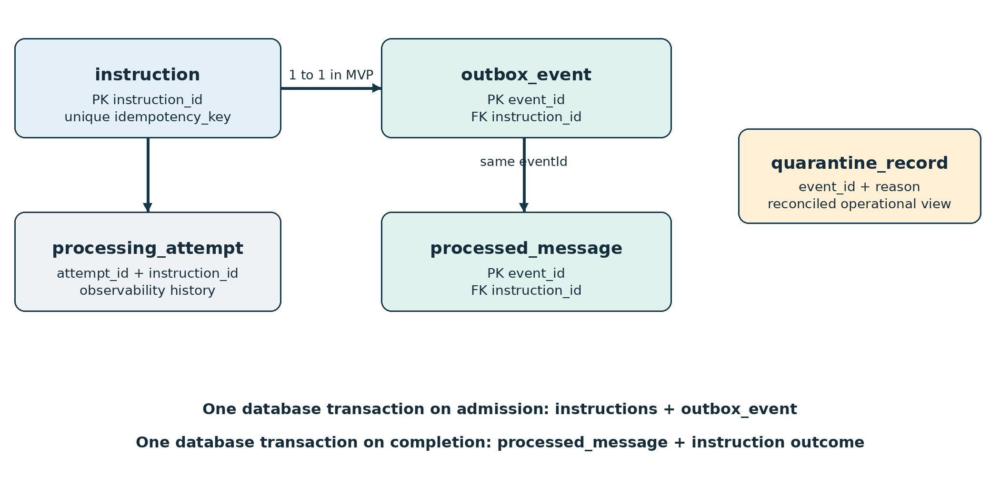
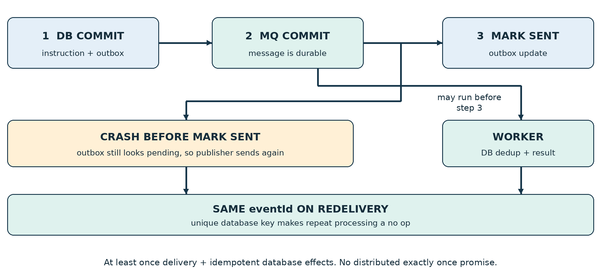
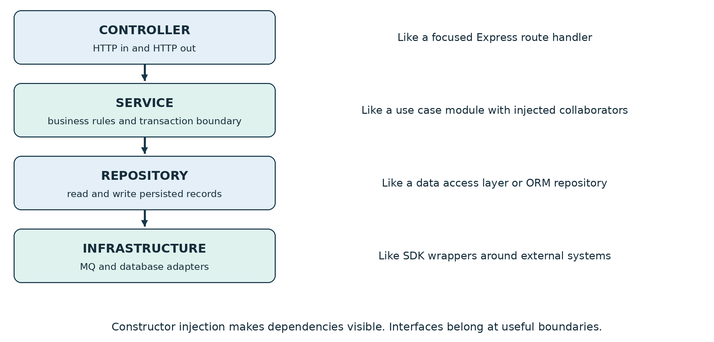
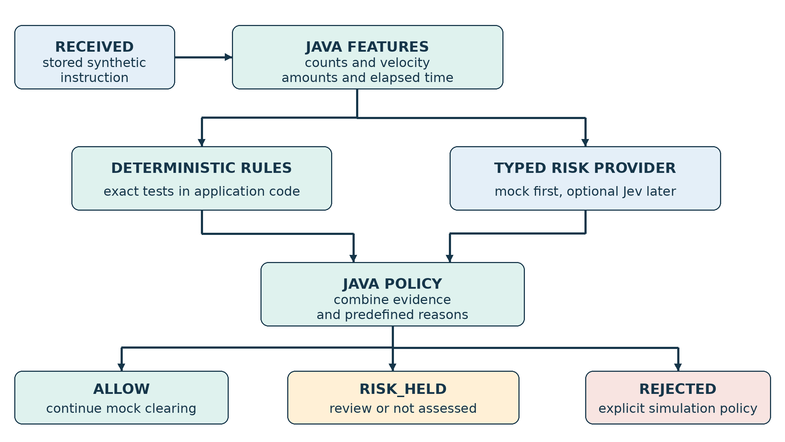

# QueueDesk Product Requirements

Section references are shared by Markdown and PDF. For local diagrams, open this Markdown from the extracted visual bundle with its images folder intact.

*Synthetic payment messaging learning guide*

A small synthetic payment messaging lab for learning Java, Spring Boot and IBM MQ. Start with one generated instruction, follow it through the system, then deliberately break the path and explain the recovery.

Prepared for an experienced TypeScript and Node developer with a solid OOP foundation who is new to Java and Spring Boot. Version 1.2 • 4 October 2026

### The product in one minute

A command line script generates fake payment instructions. A Spring Boot API records them, an outbox publishes work to IBM MQ, and a worker simulates clearing checks and a receiving bank response. PostgreSQL records the outcome. A later Angular dashboard makes the flow and failures visible. An optional Jev risk-signal exercise can follow the core MQ work; it never gates the first build.

**This is a teaching model.** It does not connect to a bank or clearing house, move money, implement a payment scheme, or reproduce an employer system. “Completed” always means completed inside this simulation.

### Start here

- Read sections 1–3 to understand the scope and first checkpoint. Do not begin with every component running.
- Use sections 5–12 as the visual and technical reference when adding MQ and failure recovery.
- Use sections 13–17 to prove behavior with the generator, tests and observable evidence.

### Success looks like this

You can submit a repeatable batch from a script, trace one instruction by ID, explain why HTTP 202 is not completion, demonstrate harmless duplicate delivery, and recover an ambiguous confirmation without creating a second instruction.

| **Read for** | **Sections** |
| --- | --- |
| Scope and requirements | 1–4 |
| Architecture and contracts | 5–11 |
| Failure lab and user experience | 12–15 |
| Testing and operational safeguards | 16–17A |
| Java learning and setup progression | 18–21 |
| Completion gates, optional risk lab and sources | 22–26 |

## 1 Product intent and scope

### Problem and learning goal

Messaging systems separate accepting work from finishing it. That separation makes buffering and recovery possible, but creates duplicates, delayed results and uncertainty. QueueDesk gives those ideas a small, inspectable home while you learn Java syntax and Spring conventions.

The business story is a mock sending bank submitting a payment instruction to a mock clearing service, which asks a mock receiving bank for an outcome. These are roles in the simulation, not three mandatory deployed services.



*Figure 1  The business story is three mock roles*

### People using the lab

| **Role** | **Need** | **Evidence of success** |
| --- | --- | --- |
| Developer learner | Understand each layer and its failure boundary | Can explain and change the path without copying unexplained code |
| Lab operator | Find what is delayed and why | Filters by run and instruction; distinguishes pending, rejected and quarantined |
| Scenario author | Produce realistic but bounded traffic | Same seed and configuration reproduce payloads and intended faults |

### Confirmed direction and proposed defaults

Confirmed direction: use a script to generate submissions, make the lab relevant to transaction messaging, teach Java and Spring Boot incrementally, and provide visual explanations. The optional Jev fraud-risk learning module is also in scope after the core MQ flow. Its thresholds and live-provider use remain open. Other implementation details are proposed defaults for review.

Proposed defaults: Java command line generator; Maven; PostgreSQL; IBM MQ; one backend codebase; polling read API; USD-only synthetic amounts; read-only Angular after the backend works. Employer versions, operating system compatibility and daily study time remain open.

### Out of scope

- Real money, bank connections, account/routing numbers, payment credentials, customer data, or actual purchases.
- A real ledger, funds availability, settlement finality, scheme certification, ISO 20022 conformance, real-world fraud decisions or regulatory compliance claims. The optional risk module evaluates synthetic fixtures only.
- A production SaaS, multi-tenancy, public deployment, Kubernetes, high availability and paid cloud services in the MVP.
- Manual payment entry as the main workflow. A dashboard never replaces the required generator.

## 2 Build in learning stages



*Figure 2  Learn one boundary at a time*

| **Stage** | **Scope** | **Exit checkpoint** |
| --- | --- | --- |
| L0 Foundation | Pure Java model, validation and dry run generator | Explain records, interfaces and exceptions; repeat a seeded batch |
| L1 Walking skeleton | HTTP API, Postgres, GET status; no broker required | One valid instruction is durably RECEIVED; invalid input creates nothing |
| L2 Core MVP | Outbox, MQ, one worker, mock outcomes, deduplication | Generated instructions reach a correct simulated outcome |
| L3 Reliability gate | Bounded retries, quarantine, lost response and reconciliation | Pass failure scenarios with no duplicate outcome |
| L4 Optional next | Read-only Angular, then deployment exercises | Explain UI freshness and deployment boundaries |
| L5 Optional risk lab | Rules plus a mock risk provider, then optional Jev | Explain typed signals, holds and held-out evaluation; no live provider required |

L1 is deliberately incomplete: it proves admission and retrieval, not asynchronous processing. L2 is the smallest end-to-end product. Do not describe it as reliable until the L3 recovery tests pass. Infrastructure learning starts only after a comfortable local loop. L5 requires L2 and is best attempted after L3; it can precede Angular. It is optional, outside the core two-week target.

## 3 The first walking skeleton

Build this before adding MQ. It should be small enough that you can describe every step from an HTTP request to a saved row.

### The first demonstration

- Generate ten fake instructions in dry run mode. Inspect the JSON and totals before any requests are sent.
- Start the Spring Boot API and one local PostgreSQL database. Apply the initial database migration.
- Explicitly send one valid instruction to loopback. The API validates it, commits a RECEIVED row and returns HTTP 202 with a status URL.
- Read the same instruction using GET. Restart the API and read it again. Persistence survives the application restart.
- Send an invalid amount and a duplicate idempotency key. Show the documented error and repeat-request behavior.

### Walking skeleton requirements

| **ID** | **Requirement and acceptance** |
| --- | --- |
| SK01 | A Java domain model represents one synthetic instruction. Amount is an integer minor-unit value; validation is tested without Spring. |
| SK02 | The API returns 202 only after its database transaction commits. A failed commit must never be reported as a successful admission. |
| SK03 | GET returns the saved instruction and current state. Unknown IDs return 404. No worker outcome is invented. |
| SK04 | The generator defaults to dry run and loopback. Re-running a seed creates the same business payloads. |
| SK05 | A runbook explains startup, migration, one sample request, tests and shutdown. No MQ, Angular or cloud is needed for this checkpoint. |

### What to learn while building it

Use a Java record for an immutable request DTO, a service for the use case and a repository for persistence. Practice constructor injection and reading a stack trace. Keep business validation in plain Java where possible; let Spring assemble and expose the application.

**Checkpoint question** Why can an instruction be RECEIVED after a restart while nothing has been processed yet? If that distinction is unclear, stay at this stage.

## 4 Traceable product requirements

Priority M means required for the named stage. Priority Later means explicitly deferred. Each requirement points to a testable result; the detailed scenarios in sections 14 and 16 provide the evidence.

| **ID** | **Stage** | **Requirement and acceptance** |
| --- | --- | --- |
| PR01 | L2 M | The script is the primary producer. A seeded 20-instruction normal run reaches 20 distinct simulated outcomes; dashboard entry is unnecessary. |
| PR02 | L1 M | Validate before persistence. Bad schema, amount or participant returns 400 and creates no instruction or event. |
| PR03 | L2 M | Commit admission and outbox event together. Database rollback leaves neither record; broker outage leaves durable pending work. |
| PR04 | L2 M | A repeat key with identical semantic payload returns the existing instruction; a changed payload returns 409. Concurrent submissions cannot create duplicates. |
| PR05 | L2 M | Use stable event and instruction IDs. Repeated delivery produces one durable business outcome and a visible dedup count. |
| PR06 | L3 M | Retry only classified transient failures under a bounded policy. Poison work reaches quarantine without an endless hot loop. |
| PR07 | L3 M | An unknown receiving-bank outcome remains pending. Reconciliation uses the original instruction ID and cannot silently create a new instruction. |
| PR08 | L2 M | Every admitted instruction is retrievable by ID and run ID. Status includes outcome, delivery detail and meaningful timestamps. |
| PR09 | L3 M | The failure matrix and crash-window tests pass. Restart restores progress without deleting stored data. |
| PR10 | L1 M | All defaults are local, synthetic, bounded and dry run where applicable. The lab never targets a real payment endpoint. |
| PR11 | L4 Later | Read-only Angular shows summary, filtered list, detail timeline and freshness. API remains the source of truth. |
| PR12 | Later | Replay or manual resolution requires explicit selection, confirmation, reason and audit. No bulk automatic replays in the MVP. |

L5 adds PR13–PR16 in section 23. These are mandatory only if that optional module is selected. Telemetry acceptance TG01–TG04 in section 17A grows with the same learning stages.

Nonfunctional target: correctness and explainability outrank throughput. Initial load targets are lab acceptance criteria, not performance claims or banking service-level objectives. Record measured latency and resource use on your own machine.

## 5 System architecture


*Figure 3  Proposed target architecture with optional risk and telemetry stages. This describes the design, not the current implementation.*

### Responsibilities and boundaries

| **Component** | **Owns** | **Does not own** |
| --- | --- | --- |
| Generator | Seeded fake inputs, bounded pacing, request/result report | Business outcomes or database writes |
| API service | Validation, idempotent admission, read endpoints | Claiming that accepted work has completed |
| Outbox publisher | Durable event dispatch with a stable eventId | Changing a business result after MQ send |
| MQ | Queueing and redelivery under configured transactions | Making database updates atomic with message delivery |
| Worker and simulators | Mock clearing policy, mock receiver, durable outcome | Real transfers, actual settlement or compliance checks |
| Postgres | Instruction truth, outbox, dedup and outcome records | Inferring that a missing response means rejection |

Start with one Spring Boot codebase and one worker consumer. Profiles can enable API, publisher and worker roles separately later. The mock institutions are Java interfaces and implementations, not extra microservices. The dashboard never connects directly to MQ or the database. If L5 is enabled, a RiskGate runs in the worker before mock clearing, behind a RiskSignalProvider interface. Solid arrows show the logical instruction path; telemetry export is a side path. Micrometer metrics may be read locally or scraped directly by Prometheus; a Collector and centralized backends are optional, not prerequisites.

## 6 Status and acknowledgement model



*Figure 4  Core flow business status and delivery status are separate. Optional L5 inserts the risk gate shown in Figure 8 before mock clearing.*

| **Signal** | **What it proves** | **What it does not prove** |
| --- | --- | --- |
| HTTP 202 | Admission committed locally; status URL is available | MQ delivery, clearing acceptance or final outcome |
| MQ send commit | Broker accepted a persistent message under its configured guarantees | Worker completion or mock receiver acceptance |
| BUSINESS_ACCEPTED | Mock clearing checks passed | Simulated receiver completed the instruction |
| COMPLETED_<br>SIMULATED | A definitive successful mock outcome was recorded | Any real money moved |
| Timeout or missing reply | No definitive reply was observed by the deadline | Rejection, non-delivery or permission to create a replacement |

Allowed state transitions: RECEIVED → BUSINESS_ACCEPTED or REJECTED; BUSINESS_ACCEPTED → COMPLETED_SIMULATED, REJECTED or PENDING_CONFIRMATION; PENDING_CONFIRMATION → a definitive simulated outcome. If still unknown, it stays pending. No automatic terminal failure merely because time elapsed.

With L5 enabled, RECEIVED can become RISK_HELD or REJECTED before clearing. ALLOW only permits the existing clearing checks. An explicitly audited review can move RISK_HELD back to RECEIVED for the same instruction, or to REJECTED. NOT_ASSESSED is an assessment result, not settlement or business completion. Risk holds never turn into ALLOW because a timeout expires.

Delivery detail is separate: PENDING_PUBLISH, PUBLISHED, RETRYING or QUARANTINED. A published flag may lag a successful worker due to the outbox crash window. Display timestamps and evidence, never derive completion from queue depth.

## 7 HTTP contract

Proposed base path: /api/v1. All examples are synthetic. The first version accepts one instruction per POST; batch traffic is the generator sending many individual requests.

```text
POST /api/v1/instructions
Idempotency-Key: demo-0042-0001
X-Correlation-Id: request-0042-0001
Content-Type: application/json
{
  "clientReference": "demo-0042-0001",
  "runId": "demo-0042",
  "senderParticipant": "SENDER_A",
  "receiverParticipant": "RECEIVER_B",
  "amountMinor": 12500,
  "currency": "USD"
}
```

12500 means USD 125.00 in this lab. Use Java long and PostgreSQL BIGINT with positive range checks; never binary floating point for amounts. The MVP permits only USD and fixed synthetic participant tokens. Multi-currency scale and conversion are deferred.

| **Response** | **Contract** |
| --- | --- |
| 202 new | Return instructionId, status RECEIVED, receivedAt and statusUrl. Include Location. Commit before sending the response. |
| 200 repeated | Same idempotency key plus same normalized business payload returns the existing instruction and its current state; no new outbox event. |
| 400 or 413 | 400 for invalid fields or schema; 413 above the 16 KiB body limit. Structured errors and no rows. |
| 409 conflict | Same key with different semantic payload. Do not overwrite the original instruction. |
| 503 unavailable | Admission could not be completed or capacity guard is active. A lost response can still be ambiguous; retry only with the original key. |

GET /instructions/{id} returns state, reasonCode, delivery detail, identifiers and timestamps. GET /instructions?runId=...&status=...&limit=50 uses bounded pagination. A status read can return 404 for an unknown ID; a retrying client still keeps the original key. L5 adds riskStatus, assessmentId and predefined riskReasonCodes to reads; HTTP 202 still means admission only.

POST semantic hash: canonicalized clientReference, runId, participants, amountMinor and currency. Exclude request correlation metadata. Enforce idempotency with a database unique constraint, not only a Java pre-check.

## 8 Message and error contracts

```text
Queue: QUEUEDESK.INSTRUCTION.IN
Content: UTF-8 JSON, persistent delivery
{
  "schemaVersion": 1,
  "eventType": "InstructionReceived",
  "eventId": "6b6d305a-4412-4ca0-bbb3-22efe3a5a871",
  "instructionId": "854897a4-3204-441f-a031-680f11646a00",
  "runId": "demo-0042",
  "occurredAt": "2026-10-04T18:00:00Z",
  "correlationId": "request-0042-0001",
  "payload": {
    "senderParticipant": "SENDER_A",
    "receiverParticipant": "RECEIVER_B",
    "amountMinor": 12500,
    "currency": "USD"
  }
}
```

### Identifiers have different jobs

| **Identifier** | **Meaning and lifetime** |
| --- | --- |
| Idempotency key | One client submission intent. Preserve through HTTP retries. Same key plus different payload is a conflict. |
| instructionId | Server-created business identity. Keep through processing, uncertain confirmations and reconciliation. |
| eventId | One logical event identity. Preserve on outbox re-send and MQ redelivery; primary dedup key. |
| runId | Groups a generator scenario and its final report. A fresh run normally has a fresh namespace. |
| correlationId | Links request, logs and event. Use a bounded sanitized value. Do not depend on it for uniqueness. |
| JMSMessageID | Transport identity assigned by the provider. It can change when the same event is sent again. |

Unknown schema versions, malformed messages and impossible invariants are quarantined with a stable reason code. Business rejection is an ordinary simulated outcome, not poison. Do not deserialize arbitrary Java objects from messages.

Use stable codes such as INVALID_AMOUNT, UNSUPPORTED_PARTICIPANT, DUPLICATE_PAYLOAD_CONFLICT, UNSUPPORTED_SCHEMA and RECEIVER_OUTCOME_UNKNOWN. Keep detailed stack traces in local logs; API errors must not expose secrets or internal connection strings.

## 9 Persistent data model



*Figure 5  Durability and duplicate prevention live in the database*

| **Record** | **Minimum useful fields and constraints** |
| --- | --- |
| instruction | instruction_id PK; idempotency_key UNIQUE; request_hash; run_id; participants; amount_minor; currency; state; reason; created_at; updated_at; version |
| outbox_event | event_id PK; instruction_id FK; payload; schema_version; dispatch_state; attempt_count; next_attempt_at; published_at; last_error |
| processed_message | event_id PK; instruction_id FK; handled_at; outcome_reference. Insert with business updates in the same transaction. |
| processing_attempt | attempt_id; instruction_id; event_id; start/end; result; reason. Observability, not the source of business truth. |
| L3 simulator and quarantine | receiver_result keyed by instruction_id; quarantine_record keyed by event_id; reconciliation_task with unique instruction_id, next_check_at, count and status. No real account or balance fields. |

Keep durable instruction_audit transition records with instructionId, old/new state, reason, timestamp and actor/source. Commit each required business transition and its audit row together; diagnostic logs or sampled spans cannot replace this record.

L5 adds a risk_assessment record keyed by instructionId plus feature, question and policy versions; keep attempt status, input hash, typed answers, reason codes and timestamps. A review record links its actor, reason and continuation event to the original instruction.

For the MVP, create one InstructionReceived event per instruction. Keep records for the lab run; do not expire idempotency or dedup keys during a run. Index run_id, state and due outbox rows. Use database migrations and UTC timestamps. Avoid putting all logic in database entities.

Failure attempt rows written inside a rolled-back transaction vanish. Record technical failure telemetry after rollback using a separate controlled write, or logs if the database is down. A telemetry failure must not acknowledge uncommitted business work. L5 may emit a distinct, deduplicated review-continuation event through the outbox; it preserves the original instructionId and creates no replacement payment intent.

## 10 Reliable publishing with an outbox



*Figure 6  A duplicate is the safe recovery from an uncertain publish*

### Required sequence

- Admission transaction: insert the instruction and its outbox event together. Return HTTP 202 only after commit.
- Publisher: find due pending events, publish persistent JSON using a local transacted JMS session, then commit the MQ send.
- Only after the MQ commit succeeds, mark the event PUBLISHED in a new database transaction.
- If the process dies before that last write, send again using the original eventId. Never generate a new eventId during a retry.

There is no atomic commit across PostgreSQL and MQ in this design. The outbox prevents the “database committed but event forgotten” gap. Idempotency makes the intentional duplicate window safe. It does not make the transport exactly once. [S3, S6]

### Keep the first publisher simple

Use one publisher and a bounded polling batch, such as ten events. Pause or exponentially back off on connection failure. Do not let worker progress depend on the outbox published timestamp arriving first. If you later add publisher replicas, design leases or row locking and test crash recovery before claiming safe concurrency.

Broker downtime leaves pending events visible and intact. A growing backlog triggers the local capacity guard; it is not a reason to delete instructions or silently drop messages. Publisher retries and consumer retries are separate counters.

## 11 Worker and mock participant behavior

### One message at a time first

The worker consumes a message under a local JMS transaction. It validates the envelope, opens a database transaction and checks eventId against processed_message. If already handled, it safely finishes the JMS delivery without repeating a business effect.

In L5, close the initial read transaction before provider work; the final transaction rechecks the unique event marker. For a new event, the worker first applies the optional L5 risk gate if enabled, then runs a small ClearingHousePolicy and ReceivingBankSimulator, records the definitive result and processed_message in one database transaction, then returns so the JMS delivery can commit. A crash after DB commit but before JMS commit causes a duplicate that the database key absorbs.

**Important Spring boundary** An ordinary database @Transactional annotation does not automatically include JMS. Configure the listener transaction mode and DB service boundary explicitly. Do not acknowledge before the database result commits. Configure rollback for intended exceptions and invoke the transactional service through Spring; self-invocation can bypass proxies. Test the actual combination. [S3, S9]

### Minimal business rules

- All data is synthetic. Only the configured mock sender and receiver tokens are accepted.
- Positive USD minor-unit amounts must fit a proposed lab range of 1 through 10,000,000. The upper limit is an exercise constraint, not a banking rule.
- The mock clearing policy deterministically accepts or rejects based on the scenario fixture. A business rejection commits a REJECTED result and is acknowledged normally.
- A successful mock receiver produces COMPLETED_SIMULATED. No ledger, balances or money movement is implied.

### Add uncertain confirmation only in L3

Introduce a ReceiverGateway interface. Its fake implementation stores one durable simulated result per instructionId before optionally losing the response. The stored result represents the mock participant’s independent truth; its write is intentionally separate from the worker transaction. Repeated calls return the saved result for the same instructionId rather than applying or rerolling the outcome. This is a teaching stand-in for a remote participant, not evidence that a real integration is safe.

On a deliberately lost response, record PENDING_CONFIRMATION and a reconciliation task atomically with handling the event. Reconciliation queries the fake receiver by the same instructionId. If unknown, keep pending; if definitive, update the original instruction. Never create a replacement merely because a deadline expired.

## 12 Failure and recovery policy

| **Failure** | **Expected durable behavior** | **Recovery and evidence** |
| --- | --- | --- |
| DB unavailable at admission | No successful admission may be claimed | Return 503 if a response is possible; client retries same key after recovery |
| MQ unavailable after admission | Instruction RECEIVED; outbox stays pending | Publisher backs off; resume and drain without losing events |
| Publisher crashes after MQ commit | Possibly two deliveries of one eventId | One final result; duplicate count rises |
| Worker crashes before DB commit | No committed worker DB result; MQ redelivers | Restart; event runs again |
| Worker crashes after DB commit | Result already durable; MQ may redeliver | Dedup prevents a second result |
| Transient receiver error | Retain current business state | Bound retries; if response might have been applied, reconcile first |
| Lost receiver confirmation | PENDING_CONFIRMATION; stable instruction ID | Lookup simulated receiver result; do not infer rejection |
| Malformed or unsupported event | No false successful result | Route to backout/quarantine; keep evidence and reason |
| Quarantine route unavailable | Original work must not be silently acknowledged | Rollback or stop consumer; alert; repair routing |
| DB down during quarantine projection | MQ quarantine may exist without a DB view | Show projection freshness and reconcile later |

### Bounded retries

Proposed local policy: a maximum of three failed processing deliveries before quarantine, with pacing at the listener or recovery layer. Use capped delay and jitter for reconnection and publisher retries. Do not create a blocking sleep inside every business transaction. Prove the configured attempt counts; provider backout counters and application counters are not interchangeable.

### Backout is not the same as a dead letter queue

An IBM MQ backout queue is used for repeatedly rolled-back poison messages; a queue-manager dead letter queue is associated with undeliverable messages. Configure BOTHRESH and BOQNAME, permissions and exact listener behavior, then test. Choose one poison-routing owner. IBM JMS fallback can use the DLQ or discard in some failure cases: prove the selected settings preserve persistent work when routing fails, or stop the listener and redesign before passing L3. BOTHRESH is a count, not a delay. [S4]

L5 provider timeouts, invalid answers, unknown signals and unavailability produce a durable RISK_HELD with NOT_ASSESSED or REVIEW, then complete the MQ delivery only after that hold commits. They must not become a silent allow or an endless redelivery loop. See sections 23–25.

Quarantine is an operational hold, not an automatic business rejection. In L3, reconcile quarantine observations into a separate operational view; never pretend an automatic MQ move also updated PostgreSQL.

## 13 Script and generator requirements

A Java CLI is the proposed implementation because it creates extra practice with records, collections, JSON, HTTP clients and tests. The contract matters more than the language. A shell wrapper may invoke the compiled CLI; manual clicking is not the workload generator.

```bash
# Proposed interface only, not an existing command
queuedesk generate --scenario normal --seed 42 --count 20
# Explicit sending is required
queuedesk generate --scenario normal --seed 42 --count 20 \
  --send --base-url http://127.0.0.1:8080 --rate 2 \
  --concurrency 1 --run-id demo-0042
```

| **ID** | **Rule** | **Acceptance** |
| --- | --- | --- |
| GN01 | Dry run by default | Print/write planned synthetic payloads and configuration without network calls |
| GN02 | Deterministic seed | Same seed and options reproduce payload sequence and intended fault choices; exclude wall-clock and server IDs |
| GN03 | Local allowlist | Only loopback targets accepted by default; redirects disabled; reject real or nonlocal hosts |
| GN04 | Bound all work | Defaults: 20 instructions, 2 requests/sec, concurrency 1, 5 sec request timeout, 60 sec run cap |
| GN05 | Protect retry identity | After timeout/503, use same idempotency key and body. Never retry validation/conflict errors automatically |
| GN06 | Finite traffic | Initial hard caps: 500 submissions, 10 requests/sec, concurrency 4, 5 min duration. Raising caps is an explicit lab change |
| GN07 | Separate send and observe | Record HTTP results first; poll every 2 seconds, with a separate 90 second completion deadline |
| GN08 | Report uncertainty honestly | Unresolved instructions remain pending in the report. A successful HTTP batch is not a completed processing batch |

Reports contain seed, configuration, runId, timestamps, attempted/accepted/repeated/invalid/unknown counts, business outcomes and latency distributions. Report HTTP latency separately from end-to-end latency. Exit 0 only when the scenario’s stated assertions pass; use a distinct nonzero outcome for unexpected unresolved results. An L5 scenario expecting a hold can pass only when that exact hold and reason are observed. Evaluation labels stay in a separate oracle file and never enter scorer input.

## 14 Reproducible scenario catalog

| **ID** | **Scenario and setup** | **Required result** |
| --- | --- | --- |
| SC01 | Normal: 20 valid instructions, seed 42 | 20 distinct admitted instructions reach COMPLETED_SIMULATED within the 90 second observation window; no unresolved records |
| SC02 | Duplicates: 20 unique plus 5 identical key/body repeats | 25 attempts, 20 instruction rows, 20 admission events; repeats map to original IDs |
| SC03 | Conflict: change amount under an existing key | 409; original payload and outcome are unchanged |
| SC04 | Invalid: zero/negative amount, wrong currency, missing participant | 400 for each; zero corresponding instruction and outbox rows |
| SC05 | Burst: up to 100 at capped rate/concurrency | No unaccounted loss; backlog rises and drains; capture timings and resources |
| SC06 | MQ outage after admission | 202 remains honest about RECEIVED; pending outbox survives restart and drains after recovery |
| SC07 | Controlled message redelivery | Same eventId delivered twice; one durable result; visible dedup evidence |
| SC08 | Crash between DB and JMS commits | Restart produces safe redelivery; original result remains unchanged |
| SC09 | Lost mock receiver reply | Original becomes PENDING_CONFIRMATION, then reconciles to receiver truth; no replacement ID |
| SC10 | Poison schema and unavailable backout route | Poison is held with reason; bad route does not cause silent message loss |
| SC11 | Mock business rejection | Definitive REJECTED with a reason; acknowledged normally, not retried as a transport failure |
| SC12 | Stop or deadline reached | Generator stops new submissions; report lists remaining pending/unknown; no fabricated success |

### How faults enter the lab

Input scenarios belong in the generator. Infrastructure outages and crash points belong in a local-only test harness or deliberate process controls, not a public request parameter. Mock receiver outcomes come from seeded scenario fixtures loaded only under a lab profile.

Optional risk scenarios RS01–RS06 are defined in section 25 and use the same safe generator limits. Do not interpret an HTTP retry or MQ duplicate as fraud evidence by itself.

The runId is the join key for reports, API queries and test evidence. Store the seed and fixture version. Repeatability means the same inputs and intentional faults, not identical thread scheduling, UUIDs or latency.

**Safety check** Fault injection must refuse to run outside the local lab profile. No test may stop unrelated containers, delete unrelated volumes or target any actual financial system.

## 15 Dashboard and operator experience

The API and CLI must prove the product first. Add Angular only after L2 works; it should visualize your learning instead of becoming a prerequisite for it.

### Read only dashboard in L4

- Overview: counts by business status, pending publish count, oldest pending age and unresolved confirmation count. Every card states its scope and last refresh time.
- Instruction list: filter by runId, status and time; bounded pagination; display synthetic reference, amount/currency, current status and age.
- Instruction detail: identifiers, immutable request, current result, reason code and ordered timeline. Show transport events separately from business events.
- Run detail: expected unique instructions versus admitted and completed results, rejection totals, duplicates and unresolved items.
- Operational view: outbox backlog, MQ connection state and quarantine projection freshness. Do not label stale or unavailable data as zero.

In L5, add a read-only risk panel: assessment status, deterministic reason text, provider/question/policy versions and last assessment time. Label probabilities by their exact question; do not display confidence as “probability of fraud.” Review actions remain deferred.

### Important UX behavior

Start with a five-second polling interval and stop polling when the view is not visible. Show loading, empty, unavailable and stale states. Use text labels and icons alongside colors. Display integer-based currency formatting consistently and make the “simulated” nature of the app permanently visible.

A detail page may show COMPLETED_SIMULATED while its outbox published marker is lagging. Explain the observation rather than overwriting the result. An unobserved intermediate state is not a missing transaction: fast transitions may happen between polls.

### Deferred controls need a separate design

Replay, retry-now, cancel, edit and manual resolution are not MVP controls. A future action must identify the exact instruction or quarantined event, show its last known state, require a reason and an explicit confirmation, and write an audit record with actor, time, old/new state and correlation ID.

Never offer “retry all pending” when outcomes are unknown. A safe replay design must preserve the logical instruction identity, distinguish technical replay from a new business request, and re-check the original outcome before any action. Authorization and audit requirements increase before multi-user access.

## 16 Test strategy and quality gates

| **Layer** | **Representative tests** | **Gate** |
| --- | --- | --- |
| Plain Java unit | Amount bounds, participant rules, hashing, state transitions, retry classification | Fast tests run without Spring, MQ or Postgres |
| HTTP and service | Validation, 202 after commit, same-key repeat, same-key changed-body conflict, 404, bounded list | All documented response contracts tested |
| Real Postgres integration | Unique constraint race, rollback, migration, outbox atomicity, dedup transaction | No in-memory DB substitution for transaction evidence |
| MQ integration | Persistent publish, local transaction rollback, redelivery, backout routing, restart | Use approved compatible IBM MQ and JMS versions |
| Failure integration | Publisher crash window, worker crash window, DB/MQ outage, missing receiver response | SC06 through SC10 pass with stored evidence |
| End to end | CLI → API → DB → MQ → worker → status | SC01 through SC05 and SC11–12 pass |
| UI later | Filters, stale/unavailable handling, keyboard access, status labels | Dashboard never manufactures completion |

L5 adds local provider contract tests, RS01–RS06 and a reproducible held-out harness test using mocks. Actual rules-only versus Jev quality comparisons belong to the optional live gate, with separate setup and a spending limit.

### Assertions that matter

Count distinct business identities, not only queue messages. Assert unique instruction rows, stable event IDs, one definitive result per instruction and no state regression on redelivery. Check both sides of a crash boundary. “The container restarted” is not a recovery assertion.

Use test-controlled hooks or latches for crash windows, rather than hoping to kill a process at the right millisecond. Assert eventual outcomes with explicit bounded timeouts and useful diagnostics; avoid fixed sleeps as the test’s only synchronization.

### A lightweight CI progression

Every commit should compile and run plain Java and HTTP tests. Add real Postgres tests next. Run MQ integration in an explicit profile or separate job after verifying image licensing and runner resources. Keep integration failures visible; never silently treat a skipped MQ suite as passed.

Testcontainers is optional and must be resource-capped. Start with one shared local dependency stack if parallel ephemeral containers strain the machine. No test can require a real bank, paid cloud account or production endpoint.

## 17 Observability security and safeguards

### Logs and metrics

Emit structured JSON logs with timestamp, component, stage, runId, instructionId, eventId, deliveryAttempt, correlationId, outcome and safe reason code. Include traceId/spanId when available, but keep instructionId as the stable business identity across retries and linked traces. Never export full instruction bodies, memo text, personal data, API keys or authorization headers. Capture duration at API admission, queue processing and end-to-end completion separately. Store UTC timestamps; use monotonic timers for elapsed durations.

| **Measure** | **Why it matters** |
| --- | --- |
| admitted, rejected, completed totals | Distinguish HTTP validation from business outcomes and current gauges |
| outbox pending count and oldest age | Detect work accepted locally but not yet confirmed published |
| dedup count and processing failures | Expose recovery behavior rather than treating duplicates as mysterious errors |
| pending confirmation count and oldest age | Show uncertainty needing reconciliation |
| quarantine count and projection freshness | Identify poison work without claiming the DB view is always current |
| API and end-to-end latency percentiles | Measure the right interval; exclude unresolved outcomes from completed latency and report them separately |
| MQ depth, oldest age and active work | Detect queue backlog and consumer delay; do not invent Kafka-style offset lag |
| exporter failures and dropped telemetry | Make diagnostic loss visible while keeping memory and retry work bounded |

Do not use instructionId, eventId or runId as metrics labels: those create unbounded cardinality. Put them in logs and traces. Start with Actuator/Micrometer counters, gauges and timers plus local JSON logs. No monitoring containers are needed for this milestone. Expose only needed endpoints and keep them on loopback. A liveness check should not force restart loops just because MQ is temporarily down. [S7]

L5 records hold/not-assessed counts, provider errors, call count, token usage and risk-gate p95/p99 latency. These describe operations. Fraud precision/recall and false positives require independently labeled evaluation fixtures; they cannot be inferred from risk flags or simulated completion. Store version and feature hashes with each assessment; omit credentials, authorization headers and unrelated raw data.

### Local safety budget

Start with one API/worker process, one Postgres and one MQ instance when needed. Before adding MQ, check free disk, memory pressure and supported CPU architecture. Set container memory/log limits, bounded pools, queue depth alerts and a conservative test count. Stop increasing load if the host is swapping heavily or the remaining disk budget is threatened.

Proposed stop thresholds: halt new generated traffic if backlog exceeds 1,000 instructions or free disk drops below a user-selected reserve, initially 10 GB. These are safeguards, not capacity claims. Always leave an explicit shutdown path; clean only named QueueDesk resources after reviewing what will be removed.

### Data and access

Use fake participants and references only. No real account details, customer names or transaction data. Keep passwords out of source control and logs; use local environment configuration. Bind API and dependency management ports to loopback. Authentication, TLS and least-privilege deployment review are mandatory before any future nonlocal exposure.

## 17A Telemetry contract and acceptance

### Trace across durable and asynchronous boundaries

Choose one instrumentation owner per operation: deliberately configured Micrometer Tracing with an OpenTelemetry bridge, or the OTel Java agent. Avoid duplicate HTTP/JMS spans. Persist trace context with the outbox; thread-local context cannot survive dispatch on another thread or after restart. Inject and extract supported context through MQ message properties, and verify the chosen Spring, IBM MQ client and instrumentation versions together. [S17, S18]

Create spans for admission, publish, each consumer attempt, risk evaluation, mock receiver and outcome commit. Correlate asynchronous work with producer-context links, or a documented single-message parent/child model. Do not keep a span open throughout a long queue wait. Each redelivery has its own processing span linked to the original work. Missing or unsampled traces never mean an instruction was lost. Spring JMS publish/process observations do not measure broker waiting time. [S18]

### Define each clock before graphing it

| **Measurement** | **Start and end** |
| --- | --- |
| API admission | Request start to durable acceptance; report HTTP errors separately |
| Outbox wait and publish | Commit to dispatch start; separately time the MQ send/commit |
| MQ wait and consumer delay | Defined enqueue/send timestamp to processing start; document clocks, redelivery and timestamp limitations |
| Worker and provider | Attempt start to finish; separately time risk gate, provider HTTP, mock receiver and DB commit |
| End to end | Durable acceptance to durable terminal result; holds remain unresolved and have their own age |

Use bounded histogram buckets suitable for each interval and compute p95/p99 over a stated window. Aggregate histogram buckets, never average per-instance percentiles. Report sample count, load and machine alongside results. For IBM MQ, use supported queue depth/oldest-age monitoring or a clearly labeled application estimate; do not claim a provider span includes queue wait. [S19]

### Acceptance grows with the lab

| **ID** | **Stage and test** | **Pass condition** |
| --- | --- | --- |
| TG01 | L1 normal, invalid and repeated HTTP input | Correlated JSON logs and bounded metrics agree with durable state; IDs never become metric labels |
| TG02 | L2/L3 publish, consume, redeliver and restart | Context survives outbox/MQ; attempts remain distinguishable; one durable outcome and audit history |
| TG03 | L3 stop telemetry exporter/backend during traffic | Processing continues; bounded buffers/timeouts/retries prevent resource growth; diagnostic drops are visible |
| TG04 | L5 success, hold, timeout and labeled evaluation | Operational decisions/latency are separate from offline accuracy metrics and their ground truth |

Add Prometheus/Grafana for metric history only when useful. Add an OTel Collector and a trace backend such as Tempo as a later exercise; Loki is optional for centralized logs. Cap retention, disk, export queues and cardinality. Never synchronously flush telemetry before HTTP acceptance or MQ acknowledgement. If an exporter fails, drop bounded diagnostic data visibly rather than blocking processing; required business audit remains part of the database transaction. [S20]

## 18 Java and Spring mental model



*Figure 7  Familiar responsibilities with a different runtime*

| **Concept** | **Useful TypeScript or Node comparison** | **Important difference** |
| --- | --- | --- |
| Java record | Readonly data object or DTO | A Java language type with generated members; not a persistence entity by default |
| Class and interface | Class plus interface contract | Java types exist at runtime; TypeScript types are mostly erased |
| Constructor injection | Pass dependencies into a module/class | Spring creates managed beans and wires them; do not hide all work in annotations |
| Spring Boot | Express app plus integrated conventions | It assembles Spring configuration and dependencies; it does not replace understanding HTTP or transactions |
| JPA entity | ORM model | Lifecycle and persistence context can affect writes and lazy loading; keep DTOs separate |
| @Transactional | Database transaction wrapper | Proxy/configuration boundaries matter; self-invocation and multiple resources need care |
| JMS listener | Queue consumer callback | Acknowledgement, rollback and redelivery semantics require explicit configuration |

Maven is closest to a build and dependency tool combining parts of package management and scripted builds. The JVM runs compiled bytecode; it is not the Java equivalent of the Node event loop. Learn exceptions, generics, collections and resource handling before adding thread-heavy code. [S1, S2, S3]

## 19 Learning exercises and checkpoints

### Foundation exercises

- Write PaymentInstruction as a plain Java type. Explain which values are immutable and why amountMinor is an integer.
- Write three failing validation tests, then implement the smallest rule to make each pass. Read the assertion failure and stack trace.
- Implement two ReceiverGateway fakes behind one interface: success and rejection. Swap implementations without changing the service.
- Generate five JSON payloads with seed 42. Change one option and explain exactly which output changed.

### Spring and persistence exercises

- Trace a POST from controller to service to repository. Identify where validation, transaction start and commit occur.
- Remove a required injected dependency and read the startup error. Restore it and explain what a bean is.
- Trigger a database constraint conflict concurrently. Explain why a pre-check cannot replace a unique index.
- Force the admission transaction to fail after the instruction insert. Prove the outbox and instruction both roll back.

### Messaging and recovery exercises

- Stop MQ after admission. Explain why the API may still accept bounded work and where that work lives.
- Repeat one eventId and prove the final result is unchanged. Then explain why JMSMessageID alone is insufficient.
- Inject a crash after the worker database commit but before JMS commit. Draw what survives and what redelivers.
- Lose a simulated receiver confirmation. Recover by lookup using the original identity. Explain why a timeout is not a rejection.

Optional L5 checkpoint: implement RiskSignalProvider as an interface, inject a deterministic fake, and prove a timeout becomes a hold. Explain why a typed answer can still be wrong before introducing the external adapter.

### How to use assistance without skipping understanding

Ask for one concept or failing test at a time. Before accepting generated code, predict its behavior, run the test and explain the result in your own words. Keep a short “what I changed and why” note. If you cannot explain an annotation or transaction boundary, stop and reduce the example.

**Ready to advance** You can make a small change, predict its effect, demonstrate the outcome and explain one failure case without relying on a memorized script.

## 20 Environment and deployment progression

| **Phase** | **Environment** | **Entry gate** |
| --- | --- | --- |
| Local first | JDK, Maven wrapper, IDE; dry-run CLI | Choose a supported JDK with the intended Boot line; compile and test |
| Local persistence | Postgres with named local volume | Confirm disk/memory budget; apply and test migrations |
| Local MQ | Approved IBM MQ developer image or supported build | Read license, confirm CPU platform/image support and compatible client |
| Local UI | Angular dev server reading local API | Backend end-to-end and reliability gates pass first |
| Optional AWS and Terraform | Explicit sandbox account and private resources | Separate authorization, cost ceiling, destroy plan, IAM/security review |
| Optional Kubernetes | Small educational deployment after simpler hosting | A concrete learning goal, resource budget and functioning health checks |

L5 begins with a local fake. A future Jev HTTP adapter requires explicit account/credential setup, data/retention review, a pinned available model, request limits and a cost cap. It is not required for this guide or the core demo.

### Do not choose versions by guessing the latest

First ask which Java, Spring Boot, IBM MQ, JMS/Jakarta client and build tool versions the team actually uses. Then choose a compatible supported learning combination and record it. A javax-based tutorial and a jakarta-based application can require different dependencies; do not mix them casually. [S1, S2, S5]

Record: JDK distribution/version; Boot version; MQ server/client version; starter or integration approach; Postgres version; Maven wrapper; OS/CPU; container engine. Pin images and dependencies only after compatibility is checked. Revisit official support matrices when setup begins.

### MQ licensing and platform gate

IBM developer offerings have usage terms. Review them before accepting or running an image; developer use does not establish production entitlement. Official prebuilt image platform support and source-build support can differ, especially on Apple Silicon. Verify the exact image manifest or official supported build path, rather than assuming any tag supports your laptop. [S5]

If the dependency stack is too heavy, continue plain Java, API and contract work using a narrow in-process adapter. Label those tests as simulations. They do not replace MQ integration evidence. Defer cloud setup rather than creating cost merely to finish the first checkpoint.

## 21 An adaptable two week path

This is a suggested sequence, not a promise of mastery or a daily-hour commitment. Treat each row as a session that may span several days. If the role begins sooner, prioritize the Java, Spring and MQ reasoning you can explain clearly.

| **Sequence** | **Focus** | **Concrete stopping point** |
| --- | --- | --- |
| 1 | Java refresh and domain types | Construct, validate and unit-test one synthetic instruction |
| 2 | CLI dry run and deterministic data | Generate a small repeatable JSON batch with safety limits |
| 3 | Spring HTTP boundary | POST validation and GET contract work with a simple adapter |
| 4 | Postgres and migrations | A RECEIVED instruction survives restart; rollback behavior is tested |
| 5 | Idempotent admission | Same-key repeat and concurrent conflict tests pass |
| 6 | MQ connection and simple consumer | One approved local message is sent and received; explain commit/rollback |
| 7 | Transactional outbox | The first generated instruction reaches a simulated outcome |
| 8 | Dedup and failure windows | Publisher and worker crash tests prove one durable outcome |
| 9 | Uncertain result and reconciliation | Lost confirmation stays pending until original outcome is recovered |
| 10 | Demo and explanation | Run normal, duplicate and outage scenarios; explain traces and write next questions |

### If time is tight

Finish L1 and a minimal L2 path before adding the UI. A working ten-instruction demonstration with an explanation of idempotency is more useful than an unfinished dashboard, cloud stack and Kubernetes deployment. Keep Angular, Terraform, Kubernetes and the optional Jev module as explicit next chapters. Do not replace core MQ failure practice with an AI integration.

### A compact study loop

Predict → implement a small piece → run the test → inspect data and logs → explain what happened → change one variable. Use the diagrams as maps, not as proof. The database rows, message observations and assertions provide the proof.

### Suggested demonstration narrative

“Here is one instruction, its stable business identity and its event identity. HTTP admission means only that it is stored. Here is the broker handoff. Here is the simulated outcome. Now I will lose a response and show why I reconcile instead of creating another instruction.”

## 22 Definition of done and decisions

### Core MVP is done when

- A new reader can run the documented local setup, use the generator and retrieve an outcome without manual database editing.
- PR01–PR05, PR08 and PR10 pass with repeatable evidence; each accepted instruction is accounted for by a durable record.
- Contracts, migrations, configuration and unit/integration tests are checked in. TG01 proves basic telemetry without a separate stack; TG02/TG03 join the later messaging/recovery gates. No real financial data or secrets are present.
- You can explain controller/service/repository boundaries, the outbox gap and the worker dedup transaction.

### The reliability claim requires a second gate

PR06, PR07 and PR09 plus the failure scenarios pass. Pending confirmations and quarantine remain visible and recoverable. No infinite retry loop, false completion or silent drop is observed. The runbook explains diagnosis, recovery, limits and shutdown. A successful happy path alone does not satisfy this gate.

| **Risk or decision** | **Proposed handling or question** |
| --- | --- |
| Too much scope too early | Freeze L1/L2 before UI and infrastructure. Which checkpoint matters most before the start date? |
| Employer version mismatch | Confirm Java, Boot, MQ and client versions before pinning the stack. |
| Local disk and memory pressure | Measure before adding containers. Can the MQ lab run safely within the chosen resource reserve? |
| Generator language | Java is recommended for learning. Keep the CLI behavior fixed if another language is preferred. |
| Poison routing ownership | Verify chosen IBM JMS and Spring listener behavior; use one routing owner and test threshold semantics. |
| Ambiguous mock result complexity | Introduce only in L3 behind ReceiverGateway; keep real ledger and payment protocol work out of scope. |
| Replay and access control | Deferred. Read-only local lab first; review authority and audit before adding write controls. |

The L5 mock milestone is done when PR13–PR16 and RS01–RS06 pass locally and the held-out evaluation harness is reproducible. Mock results prove plumbing, not Jev accuracy. The rules-only versus real Jev comparison is a separate optional live gate. Thresholds, review volume, latency budget and provider retention/availability remain open decisions.

### Deliverables to build later

One repository; source and tests; migration scripts; a safe generator; configuration examples without secrets; scenario fixtures and reports; setup/recovery runbook; optional read-only UI. This document defines that future work; it is not an implementation or an authorization to deploy infrastructure.

## 23 Optional Jev fraud risk lab

### A small experiment after the core MQ flow

L5 asks whether a few typed model signals improve a synthetic risk policy beyond deterministic rules. The first provider is a Java fake. Jev is an optional later adapter; no account, credential, purchase or live request is needed to complete the mock milestone. The base application keeps working with the module off.



*Figure 8  An optional pre-clearing risk gate with policy in Java*

### What the provider does and does not decide

Java computes amounts, counts, velocity windows, elapsed times and numeric buckets. Rules handle exact predicates. Jev answers at most two narrow semantic questions about the supplied synthetic context. Policy composition, thresholds, state changes and all side effects stay in Java. Use predefined reason codes and explanation templates, not generated model prose. [S11, S13]

| **ID** | **Required if L5 is selected** | **Acceptance evidence** |
| --- | --- | --- |
| PR13 | Isolate provider signals from Java policy; use a mock first | Swap success, uncertain and failed providers without changing policy code |
| PR14 | Fail safely before clearing | Timeout, unknown, invalid or unavailable required signal commits a hold; receiver is never called |
| PR15 | Preserve identities and evaluate honestly | Duplicate delivery does not create a second outcome; held-out labels never reach the scorer |
| PR16 | Gate live use and report limitations | No live call by default; pin versions, cap calls/cost and measure errors, tail latency and synthetic accuracy |

Use explicit modes: OFF for the original flow, RULES_ONLY for a comparison baseline, RULES_PLUS_MOCK for local learning, and RULES_PLUS_JEV only after setup approval. A provider failure must never silently switch modes or be interpreted as low risk.

## 24 Risk features contracts and state

### A versioned feature snapshot

Derive amountMinor, prior unique instruction count in a defined window, elapsed time since the previous unique instruction, new mock-receiver indicator and simple amount/baseline ratios in Java. Freeze the as-of timestamp and feature version. Exclude retries and transport duplicates from velocity. Missing history is explicit missingness, not zero. Use synthetic actor tokens; do not add real account details.

The initial semantic question can be a Choice over CONSISTENT, CONFLICTING and INSUFFICIENT_INFORMATION for whether a mock purpose matches the provided context. An optional Noul asks whether a synthetic memo pressures someone to bypass verification. Neither asks the model to authorize a payment. State text is untrusted data, never permission to change questions or policy.

| **Jev primitive** | **Documented result** | **QueueDesk interpretation** |
| --- | --- | --- |
| Choice | choice, probabilities, confidence | A selection among predefined keys; include an explicit insufficient-information option |
| Noul | noul from 0 to 1; no separate confidence | Probability of yes to one stated proposition, not a general fraud score |
| Score | score, legend, probabilities, confidence | Ordered rubric assessment; optional later, not exact arithmetic or a place for unordered N/A |

Choice/Score confidence summarizes the answer distribution. It is not independently measured correctness or probability of fraud. A valid type does not establish a correct classification. Do not combine probabilities into a fraud percentage without task-specific calibration evidence. [S11, S12]

### Normalize provider results before applying policy

RiskSignalProvider returns an application contract with assessmentId, inputHash, provider/model/question versions, typed signals, latency and evaluationStatus. Status values include OK, UNKNOWN, NOT_APPLICABLE, TIMEOUT, INVALID_RESPONSE and PROVIDER_UNAVAILABLE; these are QueueDesk adapter values, not built-in Jev sentinels. Validate exact question IDs/types, allowed keys, finite ranges, distribution totals and the approved response model. [S11]

| **Policy result** | **Durable behavior before clearing** |
| --- | --- |
| ALLOW | Continue existing mock clearing checks; does not mean business acceptance or completion |
| REVIEW | Commit RISK_HELD and a predefined reason; no receiver call |
| NOT_ASSESSED | Commit RISK_HELD for missing, uncertain or failed required signals; never silently allow |
| REJECT | Commit REJECTED only under an explicit deterministic simulation policy with a reason |

Persist the feature snapshot and a bounded assessment attempt before calling a provider. Do not hold a database transaction open during HTTP. Use a durable attempt lease to prevent concurrent calls. Retries retain the frozen versions and reuse a completed assessment; never silently re-score after a model change. Commit hold/reject plus the handled-event marker atomically; an allowed result continues the existing worker path. A crash around a paid provider call may leave unknown usage: exactly-once billing is not promised. An unfinished expired attempt becomes not-assessed rather than an unbounded automatic re-call.

An audited local review fixture may resume the same instruction through a new deduplicated continuation event, or reject it. No timeout, model score or review creates a replacement instruction. Operator review buttons and real-world authorization remain outside scope.

## 25 Risk evaluation and live provider gates

### Synthetic scenarios and leakage controls

Keep labels in an evaluator-only oracle. Use separate fixed seeds and disjoint synthetic actor histories for development, calibration and final test sets. Never expose expected labels, scenario names that reveal labels, or future outcomes in the feature snapshot. Freeze the final set before choosing thresholds. A seed reproduces data, not guaranteed identical model responses.

| **ID** | **Scenario** | **Required observation** |
| --- | --- | --- |
| RS01 | Benign normal and benign unusual activity | Report unnecessary holds and rejections; unusual is not automatically fraud |
| RS02 | Labeled suspicious velocity or conflicting context | Rules compute numeric facts; measure missed suspicious fixtures |
| RS03 | HTTP retries and MQ redeliveries | No inflated velocity or automatic fraud label; stable identities and cached assessment |
| RS04 | Missing, contradictory or adversarial memo text | Injection cannot alter policy, labels or destinations; uncertain required signals hold |
| RS05 | Provider timeout, invalid type, rate limit or wrong model | NOT_ASSESSED hold; bounded calls and no receiver invocation |
| RS06 | Restart before/after assessment save or hold commit | No second business outcome; incomplete assessment remains visible and recoverable |

First use RULES_PLUS_MOCK to validate the evaluation harness, expected counts and report format; this proves no Jev accuracy. In the optional live gate, compare RULES_ONLY against RULES_PLUS_JEV on the same held-out fixtures. Report a confusion matrix, false-alarm rate on benign cases, missed-suspicious rate, precision/recall, hold rate and unassessed coverage. Keep holds separate from definitive classifications. Check probability calibration by question; report sample size, class mix and uncertainty. Synthetic accuracy is not production fraud performance.

Measure provider latency and total risk-gate latency separately, including p95/p99, timeouts and retries. Record call/token usage and estimated cost against a capped run budget. TypeSafe’s advertised 70–500 ms is a vendor claim, not a measured QueueDesk result or SLA. Final thresholds and acceptable latency/error/cost targets require measured evidence; none are approved here. [S15]

### A safe future adapter

Official SDK documentation lists Python and JavaScript/TypeScript; Java can use the documented HTTP API behind the interface. Before optional live calls, confirm account access, explicit credential setup, permitted synthetic payloads, current terms/retention, rate limits and a total spending cap. Pin an available versioned model and record response.model, schema, features, questions, policy and fixture versions. Moving aliases require re-evaluation. [S11, S14, S16]

Use bounded request deadlines and concurrency. Start with no automatic live retries; any later retry policy must fit the same call and cost budget. A circuit breaker may stop attempts, but its output remains not-assessed. Store no secrets in prompts, reports or logs. TypeSafe describes no-training protections and enterprise zero retention; do not assume that a future account has zero retention. [S16]

**Learning checkpoint** Explain an interface, a mock, a feature snapshot, calibration and a fail-safe hold. Show why a typed confident answer can be wrong, and why risk allow, HTTP admission, MQ acknowledgement and simulated completion are different facts.

## 26 Sources and further reading

Primary documentation checked for this PRD on 4 October 2026. These sources support framework and messaging behavior; QueueDesk’s fictional participant rules and limits are design choices. Re-check compatibility, licensing and platform support when implementation starts. Links are clickable in Markdown and PDF. Jev documentation supports the optional design; it does not establish production fraud accuracy or any employer adoption.

**S1  Java language foundations**

[Oracle dev.java learning resources](https://dev.java/learn/)

**S2  Spring Boot compatibility**

[Spring Boot system requirements](https://docs.spring.io/spring-boot/system-requirements.html)

[IBM MQ JMS Spring components and version guidance](https://github.com/ibm-messaging/mq-jms-spring)

**S3  Spring JMS transactions**

[Spring Framework receiving JMS messages and transactions](https://docs.spring.io/spring-framework/reference/integration/jms/receiving.html)

**S4  IBM MQ poison and backout handling**

[IBM MQ handling poison messages](https://www.ibm.com/docs/en/ibm-mq/9.4.x?topic=applications-handling-poison-messages-in-mq-classes-jms)

**S5  IBM developer containers and platform support**

[IBM MQ container repository and documentation](https://github.com/ibm-messaging/mq-container)

[IBM MQ Advanced for Developers image reference](https://www.ibm.com/docs/en/ibm-mq/9.4.x?topic=reference-mq-advanced-developers-container-image)

[IBM developer container build and CPU architecture guidance](https://github.com/ibm-messaging/mq-container/blob/master/docs/building.md)

**S6  Transactional outbox and duplicates**

[AWS Prescriptive Guidance transactional outbox pattern](https://docs.aws.amazon.com/prescriptive-guidance/latest/cloud-design-patterns/transactional-outbox.html)

**S7  Actuator endpoint exposure**

[Spring Boot Actuator endpoints reference](https://docs.spring.io/spring-boot/reference/actuator/endpoints.html)

**S8  PostgreSQL constraints**

[PostgreSQL constraints documentation](https://www.postgresql.org/docs/current/ddl-constraints.html)

**S9  Transaction annotation behavior**

[Spring Framework declarative transaction annotations](https://docs.spring.io/spring-framework/reference/data-access/transaction/declarative/annotations.html)

**S10  HTTP status semantics**

[RFC 9110 HTTP semantics](https://www.rfc-editor.org/rfc/rfc9110.html#name-202-accepted)

**S11  Jev API and typed questions**

[TypeSafe introduction and primitives](https://docs.typesafe.ai/introduction)

[TypeSafe HTTP API contract](https://docs.typesafe.ai/api)

**S12  Confidence and probability**

[TypeSafe confidence semantics](https://docs.typesafe.ai/confidence)

**S13  Composition and model limitations**

[TypeSafe building with System One](https://docs.typesafe.ai/concepts/how-to-build-with-system-one)

[Jev 1.13 limitations and adversarial-state cautions](https://docs.typesafe.ai/model-jaggedness/jev-1.13)

**S14  Versions and Java integration route**

[TypeSafe models and aliases](https://docs.typesafe.ai/models)

[TypeSafe SDKs and direct HTTP support](https://docs.typesafe.ai/sdk)

**S15  Vendor latency claims**

[Introducing System One Models and Jev](https://typesafe.ai/blog/introducing-system-one-models-and-jev)

**S16  Provider terms and data handling**

[TypeSafe legal overview](https://docs.typesafe.ai/legal)

[TypeSafe data processing addendum](https://typesafe.ai/legal/data-processing)

**S17  Spring metrics and traces**

[Spring Boot Micrometer metrics](https://docs.spring.io/spring-boot/reference/actuator/metrics.html)

[Spring Boot tracing and client propagation](https://docs.spring.io/spring-boot/reference/actuator/tracing.html)

**S18  Asynchronous messaging instrumentation**

[OpenTelemetry messaging span conventions](https://opentelemetry.io/docs/specs/semconv/messaging/messaging-spans/)

[Spring JMS observations](https://docs.spring.io/spring-framework/reference/integration/observability.html#observability-jms)

[OpenTelemetry Java supported libraries](https://opentelemetry.io/docs/zero-code/java/agent/supported-libraries/)

**S19  Latency histograms**

[Micrometer histogram and percentile guidance](https://docs.micrometer.io/micrometer/reference/concepts/histogram-quantiles.html)

**S20  Bounded diagnostic export**

[OpenTelemetry Java configuration](https://opentelemetry.io/docs/languages/java/configuration/)

[OpenTelemetry Collector resiliency](https://opentelemetry.io/docs/collector/resiliency/)

### Glossary to keep nearby

Admission: saving a valid instruction for processing. Acknowledgement: a signal whose meaning depends on its layer. Idempotency: repeating an operation has no additional intended effect. Outbox: durable event intent stored with the business row. Redelivery: the transport delivers work again. Reconciliation: compare stored facts to resolve a missing or uncertain result. Quarantine: hold problematic work for inspection. Backpressure: slow or stop new work when the system cannot safely keep up.

Feature: a defined input computed from available data. Calibration: checking whether predicted probabilities match observed frequencies on a relevant labeled set. False alarm: a benign fixture unnecessarily flagged or held. Missed suspicious case: a labeled suspicious fixture not detected. Fail-safe hold: preserve pending work when a required assessment is missing. Typed output: a constrained value shape, not proof of factual accuracy.

A trace connects related diagnostic operations; a span records one timed operation. A span link relates asynchronous work without requiring one parent/child tree. A metric summarizes measurements across work; a durable audit records business facts. p95/p99 describe the 95th/99th percentile of a defined sample and time window.

The simulated flow is intentionally scheme-neutral. It does not model clearing schedules, actual settlement finality, regulatory deadlines or any named financial network’s operating rules.
